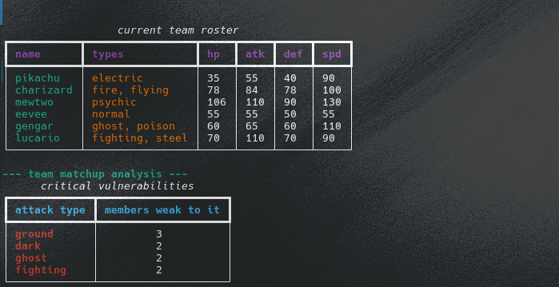
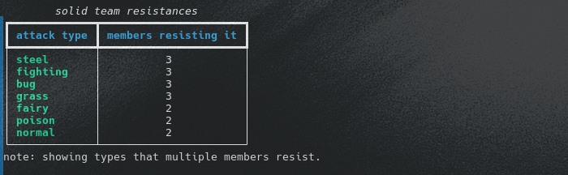

## Pokémon Team Analyzer

A lightweight CLI tool that helps you build and analyze your personal team of up to 6 Pokémon. By integrating with the [PokeAPI](https://pokeapi.co/)

### Current Features

The script dynamically fetches live data to:
* Build a custom roster of your favorite Pokémon.
* Display their base stats (HP, Attack, Defense, Speed) and types in a clean, formatted terminal table.
* Automatically analyze the team's type matchups to calculate and warn you about critical shared weaknesses (e.g., when multiple team members are highly vulnerable to Water or Rock attacks).

### How to run

- Open the terminal in the project folder.
- Optional - create and activate a virtual environment to keep dependencies clean: 
   `python3 -m venv venv`
   `source venv/bin/activate`
- Install the required libraries for API requests and terminal formatting: 
   `pip install requests rich`
- Run the script: 
   `python3 analyzer.py`

